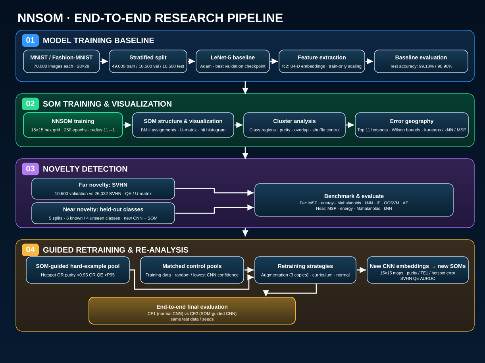

# MNIST Baseline & NNSOM Analysis (v1_mnist)

> **GWU DATS 6501 Capstone | Group 5 | Advisor: Dr. Amir Jafari**  
> _Post-Training Analysis & Novelty Detection Using Neural-Network Self-Organizing Maps_

---

## Why this matters

A model can post strong average accuracy while hiding structured weaknesses. Existing
interpretability tools — saliency maps, SHAP, LIME — explain one prediction at a time.
They answer _which pixels mattered for this sample_, not _where in the representation do
this model's failures concentrate_. That population-level view is what determines whether
a model is safe to deploy, and it is what this project tries to recover.

## Central research hypothesis

> SOM-based topology and quantization signals can expose structured regions of model
> failure in learned representation space; those signals can detect distributional
> novelty; and SOM-derived diagnostics can guide targeted interventions that measurably
> improve predictive behavior and/or the structure of the learned representation.

This is treated as a hypothesis to test, not a conclusion to prove. Components
unsupported by evidence will be reported as unsupported.

The group proposal ([`proposals/Group_proposal.md`](proposals/Group_proposal.md)) turns this into three questions:

1. **Where** on the SOM do the CNN's mistakes concentrate?
2. Can the SOM **flag inputs unlike anything the model has seen** (novelty detection)?
3. Can the SOM **choose which samples to retrain on**, and does that beat choosing at random?

## Pipeline Architecture

<p align="center">
  
</p>

## Project phases

The phases follow the project proposal ([`proposals/Project_proposal.md`](proposals/Project_proposal.md)).

| Phase                               | What is done                                                                                                | Main outputs                                                                           |
| ----------------------------------- | ----------------------------------------------------------------------------------------------------------- | -------------------------------------------------------------------------------------- |
| **1: Model Training Baseline**      | Data pipeline; train a baseline CNN; extract feature embeddings for every split                             | Accuracy, precision, recall, F1; 84-D fc2 embeddings                                   |
| **2: SOM Training & Visualization** | Train the SOM with NNSOM; Cluster Analysis; Error Pattern Analysis                                          | SOM maps, cluster purity, class–cluster intersection, error hotspots and their images  |
| **3: Novelty Detection**            | Novelty detection via quantization error; U-Matrix analysis; Comparative Evaluation                         | AUROC, AUPR, FPR at 95% TPR against Isolation Forest, One-Class SVM and an autoencoder |
| **4: Guided Retraining**            | Hard example mining; targeted data augmentation; iterative SOM re-analysis                                  | Retrained model vs. baseline; old vs. new SOM maps                                     |
| **5: Paper Writing & Code Release** | Final results and figures, paper draft, code release                                                        | Paper, documented code                                                                 |

Success criteria and thresholds are fixed **before** the test set is used, in the protocol of each step
(`src/v1_mnist/docs/`). Every change to a written rule is logged in
[`src/v1_mnist/docs/DEVIATIONS.md`](src/v1_mnist/docs/DEVIATIONS.md).

**Datasets:** MNIST is finished (this branch). The whole study will be repeated on Fashion-MNIST with the same
pipeline, in its own versioned folders. SVHN is the outside (novelty) dataset for MNIST.

## Key results

**Phase 1: CNN baseline (LeNet-5 on MNIST), measured once on the held-out test split:**

| Metric              | Value                                          |
| ------------------- | ---------------------------------------------- |
| Test accuracy       | **99.18%** (10,414 / 10,500)                   |
| 95% Wilson interval | 98.99% – 99.34%                                |
| Macro F1-score      | **0.9918**                                     |
| Misclassified       | 86 test images (0.82%)                         |
| Embedding dimension | 84 (fc2 layer)                                 |
| Train / Val / Test  | 49,000 / 10,500 / 10,500 (stratified, seed 42) |

**Phase 2: SOM on the fc2 embeddings (training and validation data only; the test split is not used):**

- **SOM training:** the official model is a 15x15 SOM, `som_15x15_nb11_ep250_s42_v2`.
  Why 15x15, and how the grid choice was checked:
  [`src/v1_mnist/docs/p2_som_training_visualization/som_nnsom_training/README.md`](src/v1_mnist/docs/p2_som_training_visualization/som_nnsom_training/README.md).
- **Feature-layer ablation:** SOMs on the earlier layer fc1 (120 numbers) locate the CNN's mistakes worse
  than SOMs on fc2 (error-cell AUROC 0.622 against 0.685, 5 SOM seeds each) and have less pure cells, which
  supports the choice of fc2. fc1 separates SVHN slightly better (+0.005 AUROC).
- **Cluster Analysis:** every one of the 225 neurons is used, and neurons are almost pure.
  The validation purity is 0.9819, against 0.1738 when the class labels are shuffled
  (1,000 shuffles, p = 0.001).
- **Error Pattern Analysis (error geography):** CNN errors concentrate in a few hotspot
  neurons (about 5% of the map holds 10–13 times its fair share of mistakes) and in neurons
  where digit classes mix. Both findings also hold on 10x10 and 20x20 SOMs
  ([`ERROR_PATTERN_ROBUSTNESS_RESULTS.md`](src/v1_mnist/docs/p2_som_training_visualization/error_pattern_analysis/ERROR_PATTERN_ROBUSTNESS_RESULTS.md)).

**Phase 3: Novelty Detection — experimental evaluation**

Phase 3 includes quantization-error novelty detection, U-Matrix
analysis, external SVHN evaluation, and comparisons with classical
and neural novelty-detection baselines.

The development evaluation uses MNIST validation (10,500 samples)
as the in-distribution reference and SVHN test (26,032 samples)
as the external out-of-distribution dataset.

Selected measured AUROC results:

| Method | AUROC |
|---|---:|
| Energy | 0.999797 |
| Max-softmax probability | 0.998495 |
| Quantization Error (QE) | 0.981107 |
| k-Nearest Neighbors (kNN) | 0.976561 |
| U-Matrix | 0.969629 |
| Mahalanobis | 0.776437 |

These values come from different historical benchmark executions
and must not be interpreted as a single equal-budget experiment.

The comparisons use one frozen CNN/SOM realization. They do not
establish independent multi-seed robustness. The official MNIST
final-test split has not been used for Phase 3 evaluation.

A harder test trains new networks on 6 digits and treats the other 4 as new (5 class splits). The SOM's QE still
detects the new digits (mean AUROC 0.912), but plain nearest-neighbour distance does better in every split (0.966),
and the comparison with max-softmax (0.944) is inconclusive.

Detailed results, historical baseline investigations, reproducibility limitations and leakage controls are in the
Phase 3 report and [`outputs/v1_mnist/p3_novelty_detection/README.md`](outputs/v1_mnist/p3_novelty_detection/README.md).

**Phase 4: Guided Retraining (5 seeds per arm, test split used once, after the protocol was frozen):**

- **Targeted augmentation:** adding altered copies of the SOM-chosen hard images cut the error in the 11 hotspot
  cells from 11.4% to 7.8% without raising the error elsewhere. Choosing the images the CNN is least sure about
  (max-softmax) worked about as well.
- **Curriculum:** letting the hard images in slowly made the CNN worse.
- **SOM re-analysis:** new SOMs on the retrained CNNs have smaller weak regions, but not purer cells. The
  least-confident arm, re-analysed later as a secondary run, shows no clear drop, and SOM guidance is not clearly better than it.
- **Novelty after retraining:** the SOM still detects SVHN, but no better than before.

**In short:** the SOM shows *where* the CNN fails (a few cells where two digits overlap) and is as good a guide for
retraining as the CNN's own confidence, but it does not find mistakes or novel images better than simple scores.

## Reports

The results are written up as LaTeX reports. Each report folder holds its `.tex` source,
the compiled PDF and a `fig/` folder with the figures it uses.

| Phase | Report                                                                                                        | Status                                       |
| ----- | ------------------------------------------------------------------------------------------------------------- | -------------------------------------------- |
| 1     | [`cnn_baseline_report.pdf`](reports/Latex_report/v1_mnist/p1_model_training_baseline/cnn_baseline_report.pdf) | Done                                         |
| 2     | [`som_cluster_error.pdf`](reports/Latex_report/v1_mnist/p2_som_training_visualization/som_cluster_error.pdf)  | Done                                         |
| 3     | [`novelty_detection.pdf`](reports/Latex_report/v1_mnist/p3_novelty_detection/novelty_detection.pdf)           | Done                                         |
| 4     | [`guided_retraining.pdf`](reports/Latex_report/v1_mnist/p4_guided_retraining/guided_retraining.pdf)           | Done                                         |
| Final | [`final_report.pdf`](reports/Latex_report/v1_mnist/Final_report/final_report.pdf)                             | Done                                         |

Progress report: [`reports/Progress_Report/v1_mnist/`](reports/Progress_Report/v1_mnist/README.md).
Technical notes: [`cnn_baseline.md`](src/v1_mnist/docs/p1_model_training_baseline/cnn_baseline_training/cnn_baseline.md)
and the other notes in [`src/v1_mnist/docs/`](src/v1_mnist/docs/).

## Repository structure

Every folder has a README that says what is in it.

```
src/v1_mnist/
  component/                         code, by project phase and step (p = phase)
    configs/                         every setting, as YAML
    pipeline/                        one runner per step, grouped by phase, + run_all.py
    p1_model_training_baseline/
      data_pipeline/                 MNIST split, class distributions
      cnn_baseline_training/         LeNet-5, evaluation, fc2 embeddings
    p2_som_training_visualization/
      som_nnsom_training/            NNSOM training, map quality, SOM figures, Optuna tuning
      cluster_analysis/              best-matching neurons, purity, cluster maps
      error_pattern_analysis/        error hotspots, robustness, comparison with simpler detectors
      interactive_report/            interactive SOM HTML report (all of Phase 2)
    p3_novelty_detection/
      qe_novelty_detection/          quantization error as a novelty score
      u_matrix_analysis/             U-Matrix novelty score, SVHN on the map
      novelty_benchmark/             comparison with seven other detectors
      held_out_class_novelty/        harder test: 6 known digits, 4 new
    p4_guided_retraining/
      hard_example_mining/           hard-image pools, curriculum comparison
      targeted_augmentation/         retraining with altered copies of the hard images
      som_reanalysis/                new SOMs on the retrained CNNs
      novelty_after_retraining/      SVHN novelty on the retrained networks
    utils/                           config, logging, run IDs and SHA-256 checks, stats, figures, retraining
  docs/                              protocols, results, DEVIATIONS.md
  shellscripts/                      run_pipeline.sh: runs the whole pipeline (run_all.py) from any folder
  tests/                             pytest tests, same phase/step folders as component/
src/v1_fashion_mnist/                Fashion-MNIST: settings (component/configs/), runner (component/pipeline/),
                                     protocol (docs/) and tests, in the same phase folders; the step code is
                                     shared from src/v1_mnist/component/
outputs/v1_mnist/    results, in the same phase/step folders (see "Data and results" below)
outputs/v1_fashion_mnist/  Fashion-MNIST results, same phase/step folders
proposals/           the project proposal and our group proposal
reports/             LaTeX reports (one per phase + final report), progress report, Word report
research_paper/      the journal paper (draft on branch feature/integrated-research-paper)
presentation/        slides
demo/                pipeline diagram and interactive HTML plots
cookbooks/           kept for walkthrough notebooks (none yet)
.github/workflows/   the automatic test run on every push and pull request
```

Figures are saved as PDF only, with fonts embedded as TrueType (`pdf.fonttype` 42), by `utils/figures.py`.
No SVG, PNG or JPG files are kept in git; the one exception is draw.io diagrams, whose `.drawio.svg` export is kept next to the `.drawio` source.

## Installation

```bash
git clone https://github.com/nazishatta/fall-2026-group5.git
cd fall-2026-group5
python -m venv .venv
source .venv/bin/activate      # Windows PowerShell: .venv\Scripts\Activate.ps1
pip install -r requirements.txt
pip install "dvc[s3]"
```

Then download the data, models and figures from S3 (this needs AWS access to the
`dats-capstone` bucket; run `aws configure` first):

```bash
dvc pull
```

## Data and results

MNIST downloads automatically via torchvision on first run. Phase 3 uses MNIST validation images as the familiar set and the SVHN test set (26,032 images, file `data/ood_svhn/test_32x32.mat`) as the outside set. Fashion-MNIST is the next dataset.

Results in `outputs/v1_mnist/` are split between git and DVC:

- **In git:** small results only — metrics and summaries (`.json`, `.csv`), READMEs, and the
  `.dvc` pointer files.
- **In DVC** (stored on S3 at `s3://dats-capstone/shared/group5/dvc-cache`, downloaded with `dvc pull`):

| Phase | Folder (under `outputs/v1_mnist/`)                                                         | Contents                                     |
| ----- | ------------------------------------------------------------------------------------------ | -------------------------------------------- |
| 1     | `p1_model_training_baseline/cnn_baseline_training/checkpoints`                             | LeNet-5 checkpoint                           |
| 1     | `p1_model_training_baseline/cnn_baseline_training/embeddings`                              | fc2 embeddings, labels, predictions (`.npy`) |
| 1     | `p1_model_training_baseline/cnn_baseline_training/logs`                                    | training and extraction logs                 |
| 1     | `p1_model_training_baseline/cnn_baseline_training/figures`, `data_pipeline/figures`        | Phase 1 figures (PDF)                        |
| 2     | `p2_som_training_visualization/som_nnsom_training/som_models`                              | trained SOMs (10x10, 15x15, 20x20)           |
| 2     | `p2_som_training_visualization/som_nnsom_training/figures`, `convergence_plots`            | SOM figures (PDF)                            |
| 2     | `p2_som_training_visualization/cluster_analysis/figures`, `error_pattern_analysis/figures` | cluster and error figures (PDF)              |
| 2     | `p2_som_training_visualization/cluster_analysis/som_15x15_nb11_ep250_s42_v2/assignments`   | best-matching-unit assignments               |
| 2     | `p2_som_training_visualization/interactive_report`                                         | interactive SOM HTML report                  |
| 3     | `p3_novelty_detection/<step>/<run ID>/` (`*.dvc` inside)                                   | score arrays, figures, held-out-digit networks and SOMs |
| 4     | `p4_guided_retraining/<step>/<run ID>/` (`*.dvc` inside)                                   | retrained checkpoints, predictions, embeddings, new SOMs, figures |

### Adding or updating results

When a pipeline step produces new data, models or figures, upload to S3 **before** pushing to git,
so that nobody pulls a pointer to data that is not there yet:

```bash
dvc add <changed folder>          # updates its .dvc pointer
dvc push                          # 1. upload to S3
dvc status -c                     #    should say everything is up to date
git add -A                        # 2. commit the .dvc pointers and small results
git commit -m "..."
git push
```

If a figure is used in a report, also copy it into that report's `fig/` folder and recompile the report.

## Quick start

Run from the project root, after `dvc pull`.

```bash
# Run the test suite (both datasets)
python -m pytest src -q

# See every step without running anything
python src/v1_mnist/component/pipeline/run_all.py --from data_pipeline --dry-run

# Redraw the SOM figures from the official 15x15 SOM, then run the cluster and
# error-pattern analyses and the report (a step whose results already exist stops
# the run; results are never overwritten, so move or delete them to redo a step)
python src/v1_mnist/component/pipeline/run_all.py --skip-training

# The same pipeline on Fashion-MNIST (settings in src/v1_fashion_mnist/component/configs/,
# results in outputs/v1_fashion_mnist/); the shell script does the same
python src/v1_fashion_mnist/component/pipeline/run_all.py --from data_pipeline --dry-run
bash src/v1_fashion_mnist/shellscripts/run_pipeline.sh
```

There is one runner per proposal step in `src/v1_mnist/component/pipeline/`. The `data_pipeline` and
`cnn_baseline_training` runners refuse to run while their results exist: running them again would replace
the frozen embeddings and change every result.
Which runners to use, and which not to: [`src/v1_mnist/component/pipeline/README.md`](src/v1_mnist/component/pipeline/README.md).

## Reproduction

Every reported number traces back through
**config -> raw result -> processed metric -> table/figure -> conclusion**.
Each run has an ID, and its results record the seed, config, library versions and input hashes.
SOM run IDs encode their settings: `som_15x15_nb11_ep250_s42_v2` is a 15x15 grid,
neighborhood 11, 250 epochs, seed 42, version 2.

## GitHub settings (`.github/`)

[`workflows/`](.github/workflows/README.md) holds the automatic checks GitHub runs on every push and pull request.

## Technologies

PyTorch, [NNSOM](https://amir-jafari.github.io/SOM/), scikit-learn, NumPy, Matplotlib, Plotly, pytest, DVC (S3), LaTeX

## Limitations

These are the limitations found in the results (full list in the final report):

- Only 92 validation mistakes, so intervals are wide and AUROC differences below about 0.1 cannot be seen.
- MNIST is easy; Fashion-MNIST is needed before drawing general conclusions.
- The grid comparison could not separate 10x10, 15x15 and 20x20; 15x15 was chosen as a trade-off between purity and topographic error.
- The SVHN results use one CNN and one SOM, and the SVHN comparisons were set up after SVHN results had been seen. The held-out-digit test uses one network per split, and its splits share digits.
- Only 146 test images lie in the hotspots, and the hotspots come from the SOM, which gives the SOM-guided arms a built-in advantage on hotspot error.
- The first augmentation settings (shifts of up to 2 pixels) failed a check made before training; all reported augmentation results use 1-pixel shifts.

## Team

- **Fyrooz Anika Khan** - Project setup and repository structure, data pipeline and CNN baseline, DVC/S3 versioning, official 15x15 SOM, grid comparison and Optuna tuning, error-pattern robustness check and error-detector baselines, SOM figures and interactive report, Phase 4 guided retraining, held-out-digit novelty test, code quality, documentation, LaTeX reports and final report
- **Nazish Atta** - CNN evaluation and embedding extraction, initial NNSOM pipeline, cluster analysis, error-pattern and hotspot analysis, interactive convergence plots, pipeline diagram, Phase 3 novelty detection, LaTeX reports

Advisor: Dr. Amir Jafari, The George Washington University, Data Science Program.
Developed as a capstone project in the GWU MS Data Science program.
